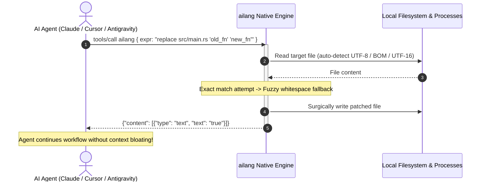

# ailang 🤖⚡

<div align="center">

**The ultra token-efficient scripting language and runtime built in Rust, engineered specifically for AI agents.**

[](https://opensource.org/licenses/MIT)
[](https://www.rust-lang.org/)
[]()
[]()
[]()

*Replace Python, PowerShell, and Bash in agentic loops — slashing token consumption by 70% to 95%.*

[Key Features](#-key-features) •
[Token Benchmarks](#-comprehensive-token-benchmarks) •
[Architecture](#-architecture) •
[Language Guide](#-language-guide) •
[Code Editing & Generation](#-first-class-code-generation--surgical-editing) •
[MCP Server](#-model-context-protocol-mcp-integration) •
[Safety & Sandbox](#-agent-safety--security-sandboxing) •
[Quickstart](#-quickstart)

</div>

---

## 🛑 The Problem: The Agent Token Tax

Modern LLM agents spend **over 40% of their context windows** transmitting scripting boilerplate, imports, error handlers, and shell wrappers.

When an agent needs to search log files for errors and save them as JSON:

```python
# 🐍 Python: ~95 tokens (plus environment setup & imports)
import glob, json

results = []
for file_path in glob.glob("**/*.log", recursive=True):
    with open(file_path, "r", encoding="utf-8") as fp:
        for line_num, line in enumerate(fp, start=1):
            if "ERROR" in line:
                results.append({"file": file_path, "line": line_num, "text": line.strip()})

with open("out.json", "w", encoding="utf-8") as fp:
    json.dump(results, fp, indent=2)
```

```powershell
# 🟦 PowerShell: ~60 tokens (verbose syntax + broken on Linux/macOS)
Get-ChildItem -Recurse -Filter *.log |
  Select-String "ERROR" |
  ForEach-Object { [PSCustomObject]@{ file = $_.Path; line = $_.LineNumber; text = $_.Line.Trim() } } |
  ConvertTo-Json | Set-Content out.json
```

```bash
# ⚡ ailang: Exactly 7 tokens. Works identically on Windows, Linux, and macOS.
glob **/*.log | grep ERROR | map({file:.path, line:.num, text:.line}) > out.json
```

> **Result:** 92% fewer tokens generated by the LLM, sub-millisecond execution, zero imports, and cross-platform determinism.

---

## 📊 Comprehensive Token Benchmarks

The table below contrasts real-world agent tasks across common runtimes. Token counts are calculated using standard OpenAI (`cl100k_base`) and Meta (`llama-3`) BPE tokenizers.

| Real-World Agent Task | Python 3 | PowerShell | Bash / Coreutils | **ailang** | **Token Savings** |
|:---|:---:|:---:|:---:|:---:|:---:|
| **Search logs & export JSON** | 95 | 60 | 45 | **7** | **-92%** |
| **Surgical code replacement** (3 lines) | 2,100 *(full rewrite)* | 2,100 *(full rewrite)* | 85 *(sed)* | **11** | **-99%** |
| **Inspect file line count** | 24 | 18 | 9 | **4** (`< Cargo.toml \| lines \| count`) | **-83%** |
| **Search codebase** (auto-ignoring noise) | 68 | 52 | 34 | **3** (`search src TODO`) | **-95%** |
| **Visual directory tree inspection** | 48 | 35 | 16 | **3** (`tree src 2`) | **-93%** |
| **Read YAML, update key, save** | 45 | 58 | 40 | **10** | **-78%** |
| **Parse CSV, filter adults, export JSON** | 50 | 42 | 38 | **10** | **-80%** |
| **Process execution with piped stdin** | 38 | 28 | 15 | **7** | **-81%** |
| **Generate file from multiline template** | 65 | 55 | 45 | **5** *(syntax overhead)* | **-90%** |
| **Calculate SHA-256 of file** | 32 | 22 | 14 | **4** (`< app.exe \| sha256`) | **-87%** |

### Runtime & System Characteristics

| Metric | Python 3 | PowerShell Core | Node.js | **ailang** |
|:---|:---:|:---:|:---:|:---:|
| **Cold Startup Latency** | ~35 ms | ~250 ms | ~45 ms | **< 0.8 ms** |
| **Runtime Memory (RSS)** | ~28 MB | ~65 MB | ~34 MB | **~3.2 MB** |
| **Binary Footprint** | Dynamic / System | ~90 MB | ~85 MB | **~6.5 MB (single native binary)** |
| **External Dependencies** | pip / venv | Modules | npm / node_modules | **Zero (statically linked Rust)** |
| **Cross-Platform Parity** | High (path quirks) | Windows-first | High | **100% Identical on all OSes** |
| **MCP Protocol Support** | Requires wrapper | Requires wrapper | Requires wrapper | **Native stdio server built-in** |

---

## 🏗️ Architecture

```mermaid
flowchart TD
    subgraph AgentClient["AI Agent / LLM Client"]
        CLI["CLI Execution (ailang \"...\")"]
        MCP["Model Context Protocol (JSON-RPC stdio)"]
        Script["File Runner (ailang run script.al)"]
    end

    subgraph ailangCore["ailang Native Rust Runtime"]
        subgraph PipelineEngine["Execution Pipeline"]
            Lexer["Zero-Copy Lexer (logos)\n• Command syntax\n• Multiline heredocs\n• Raw strings r\"...\""]
            Parser["Recursive Descent Parser\n• Stream input <\n• Sink redirection > >>\n• Multi-pipeline ;"]
            Evaluator["Streaming Evaluator\n• IndexMap Determinism\n• Token-Compressed Output\n• Piped Stdin / Stdout"]
        end

        subgraph Stdlib["Standard Library (Zero Imports)"]
            FS["fs: read, write, glob, walk, stat"]
            Edit["code: replace, replace_all, insert_after/before, prepend, append, patch"]
            Inspect["inspect: search, tree, head, tail, lines"]
            Data["data: json, yaml, csv, map, filter, sort, group, set, unique, assert"]
            SysNet["sys & net: exec, env, pwd, net.get, net.post, download"]
            Crypto["crypto: sha256, sha512, md5, base64.enc/dec"]
        end

        subgraph Security["Agent Security Sandbox"]
            Policy{"Security Policy"}
            DryRun["--dry-run (LCS Diff Preview)"]
            ReadOnly["--read-only (Block Mutating Calls)"]
            AllowDir["--allow-dir (Filesystem Jailing)"]
        end
    end

    CLI --> Lexer
    MCP --> Lexer
    Script --> Lexer
    Lexer --> Parser --> Evaluator
    Evaluator --> Policy
    Policy --> Stdlib
    Policy -.-> DryRun
    Policy -.-> ReadOnly
    Policy -.-> AllowDir
```

### Agent Interaction Lifecycle



---

## ⚡ Key Features

1. **Ultra Token Compression**:
   * Punctuation-free and parenthesis-free command-style calls (`glob **/*.log`, `grep ERROR`, `search src TODO`).
   * Stream input operator `< filename` replacing verbose read calls.
   * Auto-compressed output modes (`--output auto | json | raw | pretty`) stripping JSON whitespace.

2. **First-Class Code Editing & Generation**:
   * Surgical replacements with **fuzzy whitespace tolerance**: if an LLM outputs slightly different indentation or line breaks, `replace` matches and updates uniquely.
   * Direct code generation via multiline raw strings: `"""code""" > src/app.ts` auto-creates any missing parent directories.
   * Anchor-based insertions: `insert_after`, `insert_before`, `prepend`, `append`, and unified `patch`.

3. **Compound AI Verbs**:
   * `search src TODO`: Recursive code search that automatically ignores `.git`, `target`, `node_modules`, `dist`, and binary artifacts.
   * `tree src 2`: ASCII directory tree rendered in ~3 tokens.
   * `head 10 file` & `tail 10 file`: Instant streaming file inspection.

4. **Zero-Overhead Piped Process Execution**:
   * `exec(cmd)` captures stdout and seamlessly pipes stdin from upstream stages: `< list.txt | lines | filter(!.empty) | exec("sort") > sorted.txt`.

5. **Native Model Context Protocol (MCP) Server**:
   * Run `ailang serve --mcp` to expose an instant stdio JSON-RPC tool for Claude Desktop, Cursor, Copilot, or Antigravity.

6. **Deterministic Insertion-Ordered Output**:
   * Powered by `IndexMap` to guarantee consistent JSON keys across runs, preventing cache busting in LLM context memories.

7. **Multi-Platform Encoding Resilience**:
   * Transparently detects and decodes standard UTF-8, UTF-8 BOM, and Windows UTF-16 LE/BE files.

---

## 📖 Language Guide

An ailang script consists of one or more pipelines separated by semicolons (`;`). Data flows from left to right through pipeline stages separated by `|`.

```
<source> | <transform> | <filter> | <sink>
```

### Core Syntax & Operators

| Syntax | Description | Example |
|:---|:---|:---|
| `< path` | Stream input operator (shorthand for `read`) | `< Cargo.toml \| lines \| count` |
| `\|` | Pipeline operator: passes data to next stage | `glob *.py \| grep def` |
| `> path` | Overwrite sink (auto-creates parent dirs) | `"""content""" > dist/bundle.js` |
| `>> path` | Append sink (auto-creates parent dirs) | `"export default App;" >> dist/bundle.js` |
| `"""..."""` | Multiline heredoc raw string literal | `"""fn main() {}""" > main.rs` |
| `'''...'''` | Multiline single-quoted raw string literal | `'''SELECT * FROM users'''` |
| `r"..."` | Single-line raw string (preserves `\` verbatim) | `r"C:\Windows\System32\*"` |
| `? expr` | Inline filter shorthand | `read data.json \| json \| ? .age > 18` |
| `.field` | Object field extractor | `read user.json \| json \| .name` |
| `{k: v}` | Map / Object constructor | `map({ file: .path, size: .size })` |
| `cmd a b` | Command-style invocation (no parens/commas) | `replace src/lib.rs old_val new_val` |
| `;` | Pipeline separator for multi-step scripts | `"""code""" > app.js; replace app.js a b;` |

---

## 🛠️ Standard Library Reference

### 1. File System & Code Manipulation (`fs` / `code`)

```ailang
# Direct multiline code generation
"""
import express from 'express';
const app = express();
export default app;
""" > src/server.ts;

# Surgical replacements (with fuzzy whitespace tolerance)
replace src/server.ts "const app = express();" "const app = express();\napp.use(express.json());";

# Global replacements
replace_all src/config.py "DEBUG = True" "DEBUG = False";

# Anchor insertions
insert_after src/main.rs "fn main() {" "    env_logger::init();";
insert_before src/main.rs "fn main()" "#[tokio::main]";

# Header / Footer additions
prepend src/lib.rs "// @license MIT";
append src/routes.py "routes.register(app)";

# Unified diff patch
patch src/utils.py """@@ -10,2 +10,2 @@\n-old_calc()\n+new_calc()""";
```

### 2. Codebase Inspection (`inspect`)

```ailang
# Instant codebase search (auto-skips node_modules, target, .git)
search src "FIXME"

# ASCII tree up to depth 2 in 3 tokens
tree src 2

# Inspect file head or tail
head 15 src/lib.rs
tail 20 /var/log/syslog

# Stream input line counting
< src/main.rs | lines | count
```

### 3. Data Transformation (`data` & `text`)

```ailang
# Parse CSV, filter predicate, and serialize to compact JSON
< users.csv | csv | filter(.active == true && .age >= 21) | json > active_adults.json

# Read YAML, update property, save back
< config.yaml | yaml | set(.database.port, 5432) | yaml > config.yaml

# Extract unique matching lines
< logs.txt | lines | grep ERROR | trim | unique | count
```

### 4. Process Execution & System (`sys`)

```ailang
# Spawning processes with piped stdin and stdout capture
< entries.txt | lines | filter(!.starts_with("#")) | exec("sort") > sorted.txt

# Environment variables and working directory
env("DATABASE_URL")
pwd
```

### 5. Network & Cryptography (`net` & `crypto`)

```ailang
# HTTP Requests
net.get("https://api.github.com/zen")
net.post("https://httpbin.org/post", { key: "value" })
net.download("https://example.com/data.zip", "downloads/data.zip")

# Cryptographic Hashes & Encodings
< release.tar.gz | sha256
"secret message" | base64.enc
```

---

## 🎨 Complete Real-World Workflows

### Workflow 1: Generate, Instrument, and Export Code

```ailang
# Step 1: Create a service from scratch
"""
export class PaymentService {
    async process(amount: number) {
        return { status: 'success', id: 101 };
    }
}
""" > src/services/payment.ts;

# Step 2: Inject logging before the return statement
insert_before src/services/payment.ts "return" "        console.log(`Processing payment: ${amount}`);";

# Step 3: Add file header and export
prepend src/services/payment.ts "// Generated by AI Agent";
append src/services/payment.ts "export default new PaymentService();";

# Step 4: Verify the result
< src/services/payment.ts;
```

### Workflow 2: Find Outdated Dependencies and Alert

```ailang
< package.json | json | .dependencies | map({pkg: .key, ver: .val}) | filter(.ver.starts_with("^0.")) > outdated.json
```

---

## 🔌 Model Context Protocol (MCP) Integration

ailang natively implements the Model Context Protocol over standard I/O (`stdio`). Any MCP-compatible client can immediately delegate scripting, file manipulation, and code editing to ailang.

### 1. Launch Standalone Server
```bash
ailang serve --mcp
```

### 2. Configure Claude Desktop

Add to your `claude_desktop_config.json`:

```json
{
  "mcpServers": {
    "ailang": {
      "command": "ailang",
      "args": ["serve", "--mcp"]
    }
  }
}
```

### 3. Configure Cursor / Antigravity / Open-Source Agents

In your client configuration settings:

```json
{
  "tools": [
    {
      "name": "ailang",
      "command": "ailang",
      "args": ["serve", "--mcp"]
    }
  ]
}
```

The MCP tool accepts a single string argument `expr` containing any valid single- or multi-statement ailang program and returns structured or text results.

---

## 🛡️ Agent Safety & Security Sandboxing

When autonomous agents run scripts, defensive guardrails are critical to prevent data loss or escape:

```bash
# 1. Preview changes without touching the disk (prints LCS unified diff)
ailang "replace src/main.rs old_fn new_fn" --dry-run

# 2. Strict read-only mode (forbids write, replace, patch, exec, rm, mv, cp)
ailang "glob src/**/*.rs | lines | count" --read-only

# 3. Path Jailing (restricts all file reading/writing to a designated directory)
ailang "replace app.js a b" --allow-dir ./safe_workspace
```

---

## 🚀 Quickstart

### Installation from Source

Requirements: [Rust 1.80+](https://www.rust-lang.org/)

```bash
# Clone the repository
git clone https://github.com/nbuzzi/ailang.git
cd ailang

# Run all 34 workspace tests
cargo test --workspace

# Build the release binary
cargo build --release -p ailang-cli

# Copy to system PATH (optional)
# Linux/macOS:
cp target/release/ailang /usr/local/bin/
# Windows PowerShell:
copy target\release\ailang.exe C:\Windows\System32\
```

### Basic Commands

```bash
# 1. Inline execution
ailang "< Cargo.toml | lines | count"

# 2. Run a script file
ailang run examples/05_code_generation_and_editing.al

# 3. Benchmark token savings against Python & PowerShell
ailang bench "glob **/*.log | grep ERROR > out.json"

# 4. View the AI Prompt Sheet
ailang ref
```

---

## 📂 Repository Structure

```
ailang/
├── Cargo.toml                  # Cargo workspace definition
├── README.md                   # Project documentation
├── LICENSE                     # MIT License
│
├── crates/
│   ├── ailang-core/            # Core AST, Value enum, SecurityPolicy, Error models
│   ├── ailang-lexer/           # Zero-copy Logos tokenizer (raw strings, heredocs, commands)
│   ├── ailang-parser/          # Recursive descent parser & multi-pipeline program builder
│   ├── ailang-eval/            # Streaming pipeline evaluator (IndexMap deterministic order)
│   ├── ailang-stdlib/          # Built-in modules (fs, code, inspect, text, data, sys, net, crypto)
│   ├── ailang-mcp/             # Native JSON-RPC 2.0 Model Context Protocol stdio server
│   └── ailang-cli/             # Binary CLI entrypoint (inline, run, serve, bench, ref)
│
├── docs/
│   ├── language-spec.md        # Formal BNF grammar & syntax specification
│   └── ai-prompt-sheet.md      # Compact cheatsheet (<85 tokens) for AI system prompts
│
└── examples/
    ├── 01_count_lines.al       # File reading, line splitting, count
    ├── 02_grep_and_json.al     # Filtering and structured JSON serialization
    ├── 03_hash_and_env.al      # Cryptographic hashing & environment inspection
    ├── 04_ultra_compression.al # Command-style syntax & compound AI verbs
    └── 05_code_generation_and_editing.al # Surgical code generation & replacement
```

---

## 📄 License

This project is licensed under the [MIT License](LICENSE).

<div align="center">

**ailang** — *Because AI agents shouldn't waste tokens on `import os`.*

</div>
